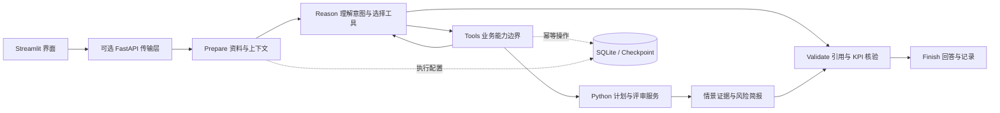

# Supply Studio

### 供应链决策 Agent · 从业务假设到可复核的计划

把“产能减少后还能守住库存目标吗？”转成可计算的情景，定位风险产品与周次，比较取舍，并把结论关联到完整假设、数据版本和方案证据。

**Python · Streamlit · FastAPI · LangGraph · SQLite · Plotly**

[快速体验](#快速体验) · [系统架构](docs/ARCHITECTURE.md) · [接口文档](docs/API.md) · [验证记录](docs/VERIFICATION.md) · [部署指南](docs/DEPLOYMENT.md) · [项目讲解](docs/PROJECT_STORY.md)


*上图由 `make_showcase.py` 调用计划引擎生成，是合成数据的计算示意图。对应数据见 [demo_snapshot.json](assets/demo_snapshot.json)。*

## 一个具体的决策问题

计划人员面对的不是单个参数，而是相互牵制的需求、产能、库存覆盖和投片时间：减少 Tester 可能通过提前生产来补偿；最后没有超产能，也可能仍有最低 Reach 风险。

Supply Studio 把流程组织成四步：

**接入并核对数据 → 设计业务情景 → 调用计划工具 → 依据证据评审方案。**

在内置虚构样例中，Tester 从8台降为6台，最大提前投片从1周变为22周。这个结果说明应同时检查投片窗口与库存目标，不能只凭单项指标选方案。这是特定样例的计算结果，不是生产环境收益或通用结论。

## 可以直接体验的能力

| 能力 | 用户得到什么 | 对应实现 |
|---|---|---|
| 对话式情景设计 | 调整产能、需求倍数与产品目标，继承未修改的假设 | `ScenarioSpec` + 白名单工具 |
| 多格式资料接入 | Excel/CSV、文档与图片；计算表和参考资料明确分开 | `file_inputs.py` + 字段映射 |
| 决策简报 | 风险产品、首次风险周、Reach缺口与待核对事项 | `scenario_insights.py` |
| 基准与取舍分析 | 明确基准、指标差值、有效参数变化及候选非支配方案 | `decision_support.py` |
| 可核验回答 | 方案引用和结构化 KPI 与工具结果核对，失败时降级 | `validation.py` |
| 可恢复任务 | 节点 checkpoint、幂等计算、输入与执行配置核对 | `conversation_agent.py` |
| 独立 HTTP 后端 | 工作区、导入、计算、对话、记录和导出接口 | `api_server.py` |
| 多层交付 | Excel明细、Markdown评审摘要、JSON证据包 | UI / API 共用领域逻辑 |

无需密钥的一键演示调用 Python 计算，不调用模型。自然语言对话需要模型连接。

## 快速体验

Python 3.13 为当前验证环境。

```bash
python -m venv .venv
source .venv/bin/activate
pip install -r requirements.txt
streamlit run Agent_App.py
```

打开页面，点击 **「一键生成演示方案」**，即可查看三组情景、产能曲线、业务风险与下载。

建议先在「方案对比」只选择基准与产能减少两组，观察库存风险和提前投片的取舍；再加入需求增长情景，查看系统如何区分公平比较与压力测试。

### 前后端联调

```bash
bash start_fullstack.sh
```

页面：`http://127.0.0.1:8504`；API文档：`http://127.0.0.1:8000/docs`。

设置 `SUPPLY_API_URL` 时，页面通过 HTTP 调用 FastAPI；未设置时直接调用领域服务。两种模式使用同一计划算法与证据口径。

### 连接模型

可在侧栏临时输入自己的密钥。也可复制 `.env.example` 到 `.env`，配置后台密钥和演示访问码；Streamlit Cloud 使用应用 Secrets。默认 public 模式不会直接向所有访客开放后台密钥。

示例对话：

> 以最初输入为基准，需求增加20%，其他条件不变，计算一个情景。
>
> 只把 Tester 改成6台，沿用其他假设，定位风险产品和最早风险周。
>
> 与刚才的情景比较：哪些参数变化了？提前投片和 Reach 风险分别如何变化？

## 模型决策与确定性计算的边界



- **状态完整性**：方案状态保存全局配置、需求倍数、产品补丁和继承关系。后续指令只修改指定字段，源表保持原样。
- **比较公平性**：需求、服务目标及最早投片约束不一致时不做优劣排名。可比情景同时展示声明规则与已报告指标上的非支配候选。
- **证据一致性**：风险简报、页面、工具和导出共用确定性实现，减少不同展示口径之间的偏差。
- **恢复一致性**：核对数据、附件、模型、提示词哈希、工具契约与预算；执行配置变化后发起新任务，已有方案可继续查看。
- **可观测执行**：记录工具参数与结果、耗时、Tokens、校验和配置指纹，展示操作事件，不暴露模型私有推理。

当前采用单 Agent + LangGraph 状态图。计划器使用规则和启发式算法；候选集内的非支配关系不代表全局最优。

## 如何验证

```bash
python -m unittest discover -s . -p 'test_*.py' -v
python evaluation.py
# 使用自己的密钥，仅发送脚本内合成数据：
python evaluation.py --live
```

**本地回归覆盖42项检查**，包括情景继承、恢复幂等、API访问隔离、上传限制、并发额度、证据校验、风险汇总、参数差异、候选取舍与真实页面交互。

评估分三层：回归测试检查程序行为；离线案例检查业务状态；真实模型案例检查参数理解、工具选择与结构化证据。具体版本、通过情况与局限见 [验证记录](docs/VERIFICATION.md)。小样本结果不代表生产准确率或业务收益。

## 工程入口

```text
Agent_App.py / presentation.py      页面装配、交互、图表与执行记录
api_*.py                            HTTP契约、鉴权、工作区锁与客户端
conversation_agent.py               LangGraph流程、预算、恢复与版本指纹
agent_contracts.py / agent_tools.py  工具契约与能力边界
planning_service.py / scenario_spec.py  完整情景、校验、幂等与导出
planning_core.py / Main.py          原始计划算法与表格归一化
scenario_insights.py                风险产品、周次、差值与证据包
decision_support.py                可比性、排序规则与非支配候选
validation.py / storage.py          约束核验、KPI核验、SQLite状态
file_inputs.py / demo_data.py        文件解析与虚构数据
```

核心算法来自作者原有的 [Opt_Simple](https://github.com/xuzoey0410/Opt_Simple) 项目。原本地工作簿和历史脚本保留在开发目录，公开包只包含所需代码与虚构数据生成器。

## 部署与开源

初次发布可将单进程页面部署到 Streamlit Community Cloud；独立后端提供 Compose 和可选域名 HTTPS 网关配置。当前尚未生成公网演示链接。

```bash
python build_release.py
```

生成 `.local/releases/supply-studio.zip` 与 SHA-256 清单。发布包采用文件白名单，排除密钥、原始业务工作簿和本机分析历史；解压后可作为独立 GitHub 仓库根目录。

详细步骤：[部署指南](docs/DEPLOYMENT.md)。本机验证过两个真实 Python 服务的 HTTP 联通；Docker/HTTPS实际运行情况见验证记录。

## 业务与使用范围

Reach为期末库存除以未来四周平均周需求；月需求采用原4/4/5周拆分。产品级目标优先于全局目标。空库存按0处理，库存截零，欠单不跨周累计。

硬性任务可能包含需求覆盖和最低库存目标，不能直接等同于真实未交付订单。当前未建模完整BOM、采购预算和成本，也未连接ERP。风险简报提供计算发现和待核对建议，不证明根因或业务目标全部满足。

Public模式提供会话/工作区隔离、后台密钥策略与共享调用限额；尚无企业账号、分布式队列和长期数据保留体系。资料在发送对话时进入配置的模型服务；API模式会先复制到所配置后端。完整说明见 [数据契约](docs/DATA_CONTRACT.md) 与 [API边界](docs/API.md)。

## 继续阅读

[三分钟演示](docs/DEMO.md) · [项目讲解与简历表述](docs/PROJECT_STORY.md) · [设计取舍](docs/ARCHITECTURE.md) · [贡献指南](CONTRIBUTING.md) · [更新记录](CHANGELOG.md)

代码使用 [MIT License](LICENSE)，依赖遵循各自许可证。
